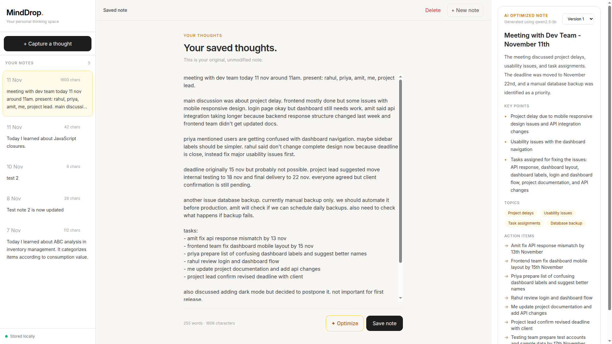

# MindDrop

> Capture first. Understand later.

MindDrop is a local-first AI note-taking application for quickly
capturing unstructured thoughts and turning them into organized,
reviewable notes with a locally running language model.

Instead of forcing you to organize your thoughts while writing, MindDrop
keeps the original note intact and lets AI generate a separate
structured version. Every optimization is saved as a version, so you can
revisit earlier results without losing the source material.




## Why MindDrop?

Ideas, lecture notes, meeting discussions, and random thoughts are often
captured in a hurry. They can be repetitive, incomplete, and difficult
to organize later.

MindDrop separates two activities:

1.  **Capture:** write freely without worrying about formatting.
2.  **Understand:** ask a local AI model to organize the saved content
    into a title, summary, key points, topics, and action items.

The original note remains the source of truth. AI output is stored
separately.

## Current features

-   **Quick capture:** write unstructured notes in a distraction-free
    editor.
-   **Local persistence:** store notes and AI-generated versions in
    SQLite.
-   **CRUD operations:** create, read, update, and delete notes.
-   **AI optimization:** use Ollama with Qwen2.5 3B to structure rough
    notes.
-   **Version history:** generate multiple AI versions for a note and
    switch between them.
-   **Source preservation:** keep the original raw note unchanged by AI
    optimization.
-   **Local-first design:** the application server, SQLite database, and
    Ollama model run on your machine.

## Tech stack

  Layer         Technology
  ------------- ------------------------------
  Frontend      React, Vite, Tailwind CSS
  Backend       Node.js, Express
  Database      SQLite with `better-sqlite3`
  AI runtime    Ollama
  AI model      `qwen2.5:3b`
  Validation    Zod
  Identifiers   UUID

## Architecture at a glance

``` text
React UI
  ├── Notes feature
  │     ├── NotesPage
  │     ├── NoteEditor / NoteList
  │     ├── useNotes / useDraftPersistence
  │     └── notesApi
  │
  └── AI feature
        ├── AIResultPanel
        ├── useNoteAI
        └── aiApi
                │
                ▼
          Express API
            ├── Notes module
            └── AI module
                  │
           ┌──────┴──────┐
           ▼             ▼
        SQLite         Ollama
     notes + versions   Qwen2.5 3B
```

See [`docs/architecture.md`](docs/architecture.md) for responsibilities,
data flow, and persistence details.

## Requirements

-   Linux, macOS, or Windows
-   Node.js with npm
-   Ollama installed and running
-   The Qwen2.5 3B model available in Ollama

## Run locally

### 1. Get the source

``` bash
git clone <your-repository-url>
cd minddrop
```

### 2. Install backend dependencies

``` bash
cd server
npm install
```

Create `server/.env`:

``` env
PORT=5000
OLLAMA_URL=http://localhost:11434
OLLAMA_MODEL=qwen2.5:3b
```

### 3. Install frontend dependencies

In a second terminal:

``` bash
cd client
npm install
```

If your API is not running at `http://localhost:5000/api`, create
`client/.env`:

``` env
VITE_API_URL=http://localhost:5000/api
```

### 4. Start Ollama

Make sure the Ollama service is running, then pull the model if it is
not already installed:

``` bash
ollama pull qwen2.5:3b
```

### 5. Start the backend

From `server/`:

``` bash
npm run dev
```

The API listens on port `5000` by default. On startup, the database
connection initializes and pending SQL migrations are applied.

### 6. Start the frontend

From `client/`:

``` bash
npm run dev
```

Open the local URL printed by Vite, normally `http://localhost:5173`.

## Typical workflow

1.  Capture a thought, lecture note, or meeting discussion.
2.  Save it. The raw text is stored in SQLite.
3.  Open the saved note and choose **Optimize**.
4.  MindDrop sends the current editor content to the backend.
5.  The backend asks Ollama to generate structured JSON.
6.  The result is validated and stored as a new version linked to the
    note.
7.  Browse the generated version history without replacing the original
    note.

> Optimization currently requires a saved note because generated
> versions are associated with a note ID.

## AI output

The structured result contains:

-   `title`
-   `summary`
-   `keyPoints`
-   `topics`
-   `actionItems`
-   `noteType`

Supported note types:

-   `idea`
-   `learning`
-   `task`
-   `reflection`
-   `reference`
-   `general`

The model is instructed to preserve the meaning of the source, avoid
inventing details, and treat the note content as data rather than
instructions.

## Data and privacy

-   Notes and generated versions are stored in the local SQLite database
    at `server/data/minddrop.db`.
-   Ollama runs locally and receives note content from the backend.
-   MindDrop does not require a hosted AI API for its current
    optimization workflow.
-   Keep the database and any exported backups private; they may contain
    personal or sensitive notes.

The database directory is excluded from Git through `.gitignore`. Do not
commit your `.env` file or private note database.

## Documentation

-   [API reference](docs/api-reference.md)
-   [Architecture](docs/architecture.md)

## Project status

MindDrop is an actively developed personal project. The current
foundation includes note CRUD, local SQLite persistence, Ollama-based
optimization, and versioned AI results. Packaging as a native desktop
application, import/export, automated tests, and additional responsive
UI improvements can be considered as later milestones.

## Design principles

1.  **Capture should be frictionless.**
2.  **The original note must remain recoverable.**
3.  **AI output should be inspectable and versioned.**
4.  **Features should have clear boundaries and responsibilities.**
5.  **Local data should remain under the user's control.**

------------------------------------------------------------------------

Built as an exploration of local-first software, practical AI
integration, and maintainable full-stack architecture.
